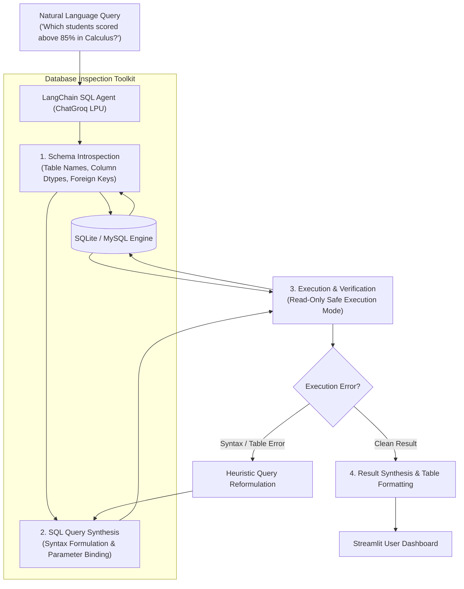

# Natural Language to SQL Query Agent

[](https://www.python.org/)
[](https://langchain.com/)
[](https://groq.com/)
[](https://streamlit.io/)
[](https://www.sqlite.org/)
[](LICENSE)

---

## Overview

Interfacing with enterprise relational databases typically requires non-technical stakeholders to rely on database engineers for custom SQL reporting. This project implements an autonomous conversational agent that bridges natural language queries with live relational databases (SQLite and MySQL) using **LangChain SQLDatabaseToolkit** and high-speed **Groq LPU inference**.

The agent inspects live database schemas, maps user intent to valid SQL syntax, executes queries safely within read-only transactions, and formats the output into structured summaries and analytical tables.

---

## System Architecture



---

## Key Capabilities

* **Dual Engine Support:** Direct file connection to local SQLite databases (`student.db`) or remote MySQL database instances over secure socket connections.
* **Schema-Aware Query Synthesis:** Programmatically retrieves table schemas and foreign key relationships before generating queries to prevent non-existent column hallucinations.
* **Execution Guardrails:** Configured with read-only execution modes and error-correction loops that intercept database driver exceptions and reformulate queries.
* **Low-Latency Streaming:** Powered by Groq-accelerated models to deliver query translation and execution summaries within sub-second latencies.

---

## Installation & Setup

### Prerequisites
* Python 3.10+
* Groq Cloud API Key

### 1. Clone the Repository
```bash
git clone https://github.com/ahmadarif238/Chat_With_SQL_DB.git
cd Chat_With_SQL_DB
```

### 2. Environment Setup
```bash
python -m venv venv

# Windows
venv\Scripts\activate
# Linux/macOS
source venv/bin/activate

pip install -r requirements.txt
```

### 3. Run the Application
```bash
streamlit run app.py
```
Open `http://localhost:8501` in your browser. Configure your Groq API key and select either the bundled SQLite database or your custom MySQL server connection in the sidebar.

---

## Author & Academic Context

Engineered by **Arif Ahmad Khan** as an exploration of schema-grounded language model agents and natural language interfaces to relational databases.

Released under the [MIT License](LICENSE).
